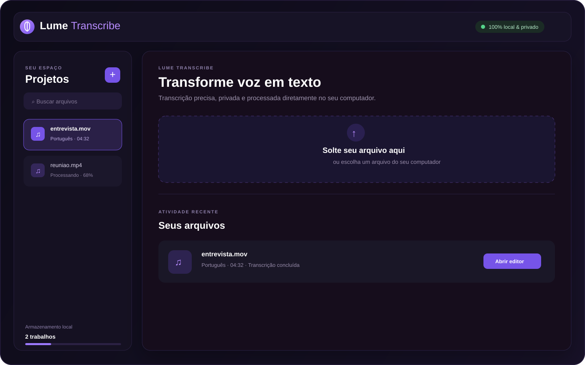

# Lume Transcribe

<p align="center">
  <strong>Transcrição local, privada e open source para áudio e vídeo.</strong><br>
  Rode o Whisper no seu próprio computador, sem login e sem enviar seus arquivos para serviços externos.
</p>

<p align="center">
  <a href="https://github.com/MarquinhoAmorim/lume-transcribe/actions/workflows/ci.yml"></a>
  <a href="https://github.com/MarquinhoAmorim/lume-transcribe/blob/main/LICENSE"></a>
  <a href="https://github.com/MarquinhoAmorim/lume-transcribe"></a>
  
</p>

<p align="center"></p>

> **Status:** versão inicial funcional. O projeto está aberto para melhorias, testes e contribuições da comunidade.

## Por que o Lume Transcribe?

Ferramentas de transcrição não deveriam exigir que vídeos pessoais, entrevistas ou reuniões fossem enviados para uma plataforma desconhecida. O Lume Transcribe usa [faster-whisper](https://github.com/SYSTRAN/faster-whisper) localmente e mantém uploads, modelos, histórico e transcrições no seu computador.

## Recursos

- Upload por arrastar e soltar ou seleção de arquivo
- MP4, MOV (incluindo vídeos do iPhone), WEBM, MKV, MP3, WAV e M4A
- Detecção automática ou seleção manual de idioma
- Fila local com progresso baseado no processamento real
- Player de áudio e vídeo com timestamps clicáveis
- Edição persistida dos segmentos da transcrição
- Cópia completa e exportação em TXT, SRT e VTT
- Histórico local e exclusão de trabalhos
- Interface web responsiva e aplicativo empacotável para macOS
- Sem login, sem banco externo e sem API paga

## Como funciona

```text
Arquivo local → FastAPI → faster-whisper → SQLite + segmentos → Editor/Exportação
```

O backend processa um trabalho por vez para manter o uso de memória previsível. O modelo é baixado apenas na primeira execução e fica no cache local.

## Requisitos

- Python 3.10 ou superior — Python 3.11/3.12 tende a ser a opção mais previsível
- Node.js 18 ou superior
- FFmpeg e FFprobe no `PATH`

No macOS:

```bash
brew install ffmpeg
```

## Instalação rápida

```bash
git clone https://github.com/MarquinhoAmorim/lume-transcribe.git
cd lume-transcribe
./start.sh
```

Depois, abra [http://localhost:5173](http://localhost:5173).

Para um passo a passo completo de replicação, consulte o [Guia de replicação](docs/REPLICATION.md).

### Instalação manual

```bash
python3 -m venv .venv
source .venv/bin/activate
pip install -r requirements.txt
npm install
npm run dev
```

Na primeira transcrição, o modelo Whisper escolhido será baixado para `data/models`. Para escolher outro modelo:

```bash
WHISPER_MODEL=small npm run dev
```

Em máquinas com GPU CUDA compatível:

```bash
WHISPER_DEVICE=cuda WHISPER_COMPUTE_TYPE=float16 npm run dev
```

## App para macOS

Com as dependências instaladas:

```bash
chmod +x scripts/build-macos-app.sh
./scripts/build-macos-app.sh
open "dist/Lume Transcribe.app"
```

O aplicativo abre o servidor local automaticamente em `127.0.0.1:8765`. Dados, uploads, histórico e modelos ficam em `~/Library/Application Support/Lume Transcribe`.

## Troubleshooting

### Erro `metadata_errors` no PyAV

Use a versão compatível:

```bash
pip install --force-reinstall "av<19"
```

### O processamento parece parado em 0–5%

Na primeira execução o faster-whisper pode estar baixando ou carregando o modelo. Aguarde alguns minutos; as próximas transcrições normalmente começam mais rápido.

### MOV do iPhone não envia

Confirme que o arquivo tem extensão `.mov`, que o FFmpeg está instalado e que o servidor local está rodando. O upload acontece antes do processamento e a interface mostra o progresso do envio.

## Verificação local

```bash
npm run build
npm run test:backend
```

O GitHub Actions executa essas verificações automaticamente a cada push e pull request.

## Replicar e contribuir

Qualquer pessoa pode criar uma cópia local, alterar o código e abrir um Pull Request. O projeto não depende de chaves de API: basta instalar Git, Node.js, Python e FFmpeg. Os modelos e arquivos enviados ficam fora do Git por meio do `.gitignore`.

Consulte também:

- [Guia de replicação](docs/REPLICATION.md)
- [Changelog](CHANGELOG.md)
- [Código de conduta](CODE_OF_CONDUCT.md)
- [Como contribuir](CONTRIBUTING.md)

## Estrutura do projeto

```text
backend/          API FastAPI, fila, SQLite e transcrição
backend/tests/    testes da API
src/              interface React/TypeScript
scripts/          inicialização e empacotamento para macOS
docs/             materiais visuais da documentação
requirements.txt  dependências Python
package.json      scripts e dependências frontend
```

## Privacidade e armazenamento

O Lume Transcribe não possui autenticação nem servidor remoto. Os arquivos ficam em `data/uploads`, os modelos em `data/models` e os metadados em SQLite. O download inicial do modelo é a única comunicação externa esperada.

## Contribuindo

Issues, pull requests, melhorias de UX, testes e documentação são bem-vindos. Consulte [CONTRIBUTING.md](CONTRIBUTING.md) antes de enviar uma contribuição.

## Licença

Distribuído sob a licença [MIT](LICENSE).

<p align="center">Feito para quem quer transcrever com controle, privacidade e simplicidade.</p>
